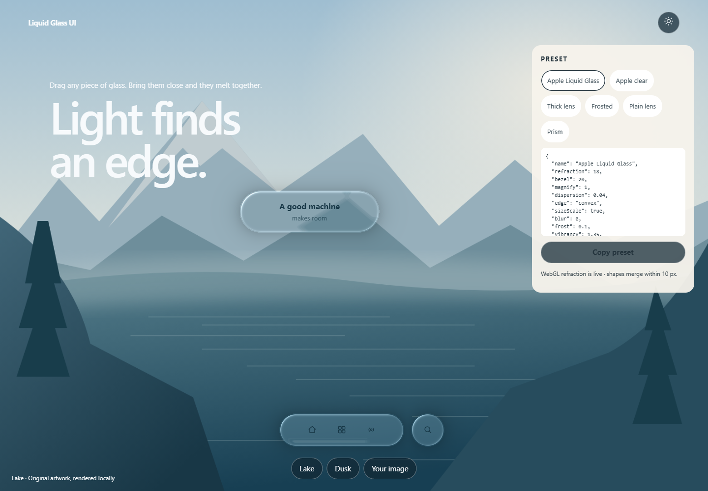

# Liquid Glass UI

An open-source skill and WebGL2 renderer for movable liquid-glass controls. Glass bends the backdrop at its edge, picks up the color beneath it, and separate controls melt together when they are dragged close.

The visual direction is informed by [Good Machines — Liquid Glass](https://goodmachines.ai/lab/liquid-glass). This repository is an independent implementation with original artwork. It does not contain that site's code or assets and is not an official Apple implementation.



## Contents

| Path | Purpose |
| --- | --- |
| [SKILL.md](SKILL.md) | Instructions for an AI coding agent |
| `assets/liquid-glass-renderer.js` | WebGL2 refraction, presets, and shape merging |
| `assets/liquid-glass.css` | Opaque and backdrop-filter fallback for controls |
| `assets/liquid-glass.js` | Optional pointer highlight for CSS controls |
| `assets/glass-backdrop.svg` | Original procedural backdrop |
| `demo/` | Draggable playground |
| [references/](references/integration.md) | Design, integration, and acceptance notes |

## Preview

```sh
node scripts/serve.mjs
```

Open the [single glass scene](http://localhost:4173/demo/). Switch among six presets from the side panel to change the same controls in place. Drag the circle onto a glass knob to merge, or across a fixed rail to see the rail refract through the circle.

### Edit and copy a button

Click a glass shape on the canvas to edit it. Use **T** in the panel to edit its text live. Drag the width and height sliders to preview changes around the button center, or enter precise pixel values. Switch between English and Simplified Chinese at the top left.

**Copy for AI** gives your coding agent the selected button's geometry, label, and material, along with pinned modules and the integration call `createLiquidGlassButton(container, config, { stage, source, requireExact: true })`. Exact mode needs a positioned stage and readable pixels. If WebGL is blocked or becomes unavailable, the button exposes `data-glass-unavailable` and uses a plain surface. Use identical source pixels, stage size, button position, browser and display scale for pixel comparisons. Compare an isolated button away from other controls because interacting surfaces change the optical field.

When using the local skill, make the selection in the main demo on port 4173. Clicking **Copy for AI** also returns the same configuration to the local server for the active agent. The server keeps the latest copy in memory.

The copy icon exports a self-contained offline JavaScript module. Paste it into a project as `glass-button.js` and mount it into an existing element:

```js
import { mountLiquidGlassButton } from './glass-button.js';

const button = mountLiquidGlassButton(document.querySelector('#preview'));
button.addEventListener('click', handleClick);
```

Both exports add a native button directly to the target page. To use the demo's WebGL optics, pass your own positioned stage and its decoded image or canvas:

```js
const button = mountLiquidGlassButton(container, { stage, source });
button.addEventListener('click', handleClick);
// When removing the component:
button.disposeLiquidGlass?.();
button.remove();
```

`stage` is a positioned ancestor of `container`. Display the source in the stage with centered cover sizing to match the renderer's sampling. For a video or a changing canvas, pass `liveSource: true` and call `button.invalidateLiquidGlass()` when new pixels are available. The WebGL layer draws only the button's lens. When no readable source is available, the button uses CSS blur and rim lighting over the page.

Development checks:

```sh
npm install
npm test
```

Tests use installed Microsoft Edge, then Playwright Chromium. Set `GLASS_BROWSER_PATH` to another browser if needed. Runtime pages do not need npm.

`node scripts/package.mjs` writes `dist/liquid-glass-ui.zip`.

## Use it as a skill

Install the folder named `liquid-glass-ui` in your agent's skills directory or in the project's `.agents/skills/` directory. The folder must contain `SKILL.md` directly. In Codex, use `$liquid-glass-ui` and identify the target controls, backdrop, and the interaction you want.

The skill chooses between CSS glass for live DOM and true WebGL2 refraction for a backdrop supplied as pixels. The [integration recipes](references/integration.md) show how to attach both paths to an existing app. The demo is a reference for checking the effect.

## Use the renderer

```js
import { GlassScene, PRESETS } from "./assets/liquid-glass-renderer.js";

const scene = new GlassScene(canvas);
const image = new Image();
image.src = "./assets/glass-backdrop.svg";
await image.decode();
scene.setSource(image);
scene.setMaterial(PRESETS.apple);
scene.setShapes([
  { x: 420, y: 640, width: 250, height: 64, radius: 32 },
  { x: 560, y: 640, width: 64, height: 64, radius: 32 }
]);
scene.render();
```

`x` and `y` are each shape's center in CSS pixels relative to the canvas. `PRESETS.apple` uses refraction 18, bezel 20, dispersion 0.04, blur 6, frost 0.1, vibrancy 1.35, pickup 0.35, specular 0.7, rim width 1.4, light angle -135, shadow 0.3, and merge 10. The other presets are `clear`, `thick`, `frosted`, `plain`, and `prism`.

The renderer displaces a texture you supply. It does not refract arbitrary HTML behind the canvas. For video or a live canvas, call `setSource` and `render` on each frame. Call `destroy()` on unmount.

## Accessibility

Labels and actions stay in DOM elements above the canvas. The canvas is hidden from assistive technology. Reduced transparency and forced colors hide the refractive canvas and show opaque controls. Targets are at least 44 by 44 CSS pixels, and the layout fits a 320px viewport.

Text needs 4.5:1 contrast, and large text or essential boundaries need 3:1, measured on the actual backdrop. There is no claim of pixel parity with the reference page or of a formal WCAG certification.

## License

New code, docs, and original artwork are [MIT](LICENSE), copyright 2026 Liquid Glass UI contributors. See [THIRD_PARTY_NOTICES.md](THIRD_PARTY_NOTICES.md) for the reference-site boundary and development dependencies.
