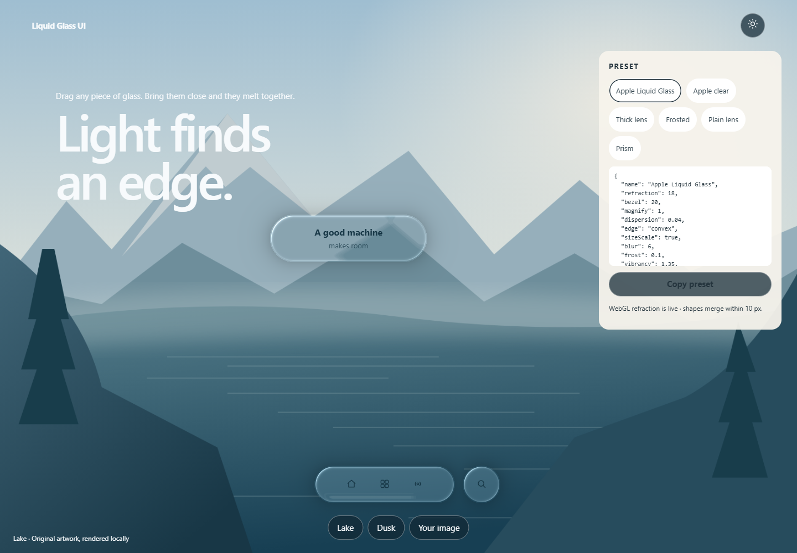

# Liquid Glass UI

An open-source skill and WebGL2 renderer for movable liquid-glass controls. Glass bends the backdrop at its edge, picks up the color beneath it, and separate controls melt together when they are dragged close.

The visual direction is informed by [Good Machines — Liquid Glass](https://goodmachines.ai/lab/liquid-glass). This repository is an independent implementation with original artwork. It does not contain that site's code or assets and is not an official Apple implementation.



## Contents

| Path | Purpose |
| --- | --- |
| [SKILL.md](SKILL.md) | Instructions for an AI coding agent |
| `assets/liquid-glass-renderer.js` | WebGL2 refraction, presets, and shape merging |
| `assets/liquid-glass.css` | Opaque and backdrop-filter fallback for controls |
| `assets/liquid-glass.js` | Optional pointer highlight for CSS controls |
| `assets/glass-backdrop.svg` | Original procedural backdrop |
| `demo/` | Draggable playground |
| [references/](references/integration.md) | Design, integration, and acceptance notes |

## Preview

```sh
node scripts/serve.mjs
```

Open <http://localhost:4173/demo/>. Switch among Controls, Panel, Lens, Morph, and iOS controls. Drag any piece; nearby pieces melt together. Clicking scales the glass, Morph splits and rejoins, and the switch, slider, and segment animate.

Development checks:

```sh
npm install
npm test
```

Tests use installed Microsoft Edge, then Playwright Chromium. Set `GLASS_BROWSER_PATH` to another browser if needed. Runtime pages do not need npm.

`node scripts/package.mjs` writes `dist/liquid-glass-ui.zip`.

## Use it as a skill

Place the unpacked `liquid-glass-ui/` folder at either location, without nesting another copy inside it:

- Project skill: `<project>/.claude/skills/liquid-glass-ui/SKILL.md`
- Personal skill: `~/.claude/skills/liquid-glass-ui/SKILL.md` (`%USERPROFILE%\.claude\skills\liquid-glass-ui\SKILL.md` on Windows)

In a new session:

```text
/liquid-glass-ui Restyle this page with movable liquid glass and merging controls.
```

You can also point an agent directly at [SKILL.md](SKILL.md).

## Use the renderer

```js
import { GlassScene, PRESETS } from "./assets/liquid-glass-renderer.js";

const scene = new GlassScene(canvas);
const image = new Image();
image.src = "./assets/glass-backdrop.svg";
await image.decode();
scene.setSource(image);
scene.setMaterial(PRESETS.apple);
scene.setShapes([
  { x: 420, y: 640, width: 250, height: 64, radius: 32 },
  { x: 560, y: 640, width: 64, height: 64, radius: 32 }
]);
scene.render();
```

`x` and `y` are each shape's center in CSS pixels relative to the canvas. `PRESETS.apple` uses refraction 18, bezel 20, dispersion 0.04, blur 6, frost 0.1, vibrancy 1.35, pickup 0.35, specular 0.7, rim width 1.4, light angle -135, shadow 0.3, and merge 10. The other presets are `clear`, `thick`, `frosted`, `plain`, and `prism`.

The renderer displaces a texture you supply. It does not refract arbitrary HTML behind the canvas. For video or a live canvas, call `setSource` and `render` on each frame. Call `destroy()` on unmount.

## Accessibility

Labels and actions stay in DOM elements above the canvas. The canvas is hidden from assistive technology. Reduced transparency and forced colors hide the refractive canvas and show opaque controls. Targets are at least 44 by 44 CSS pixels, and the layout fits a 320px viewport.

Text needs 4.5:1 contrast, and large text or essential boundaries need 3:1, measured on the actual backdrop. There is no claim of pixel parity with the reference page or of a formal WCAG certification.

## License

New code, docs, and original artwork are [MIT](LICENSE), copyright 2026 Liquid Glass UI contributors. See [THIRD_PARTY_NOTICES.md](THIRD_PARTY_NOTICES.md) for the reference-site boundary and development dependencies.
